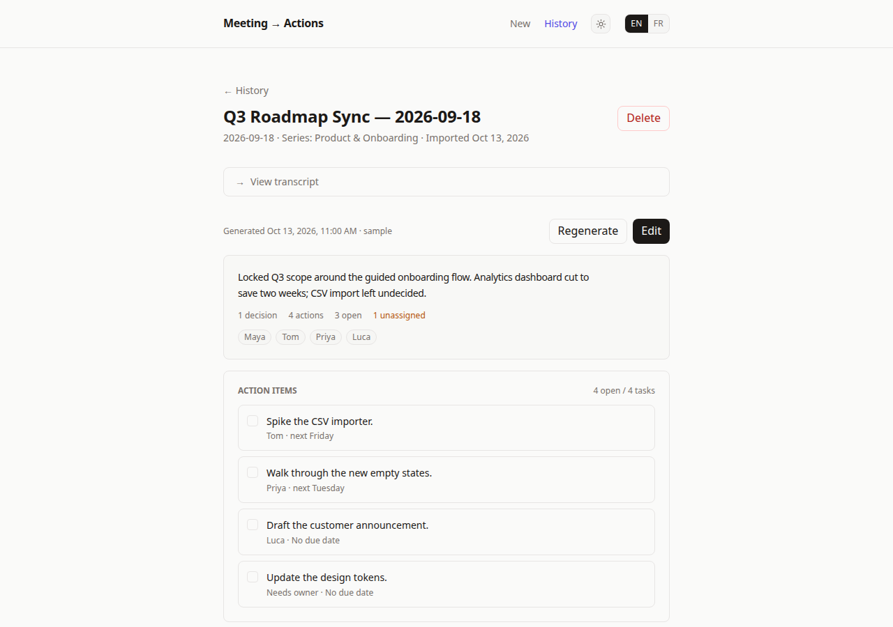
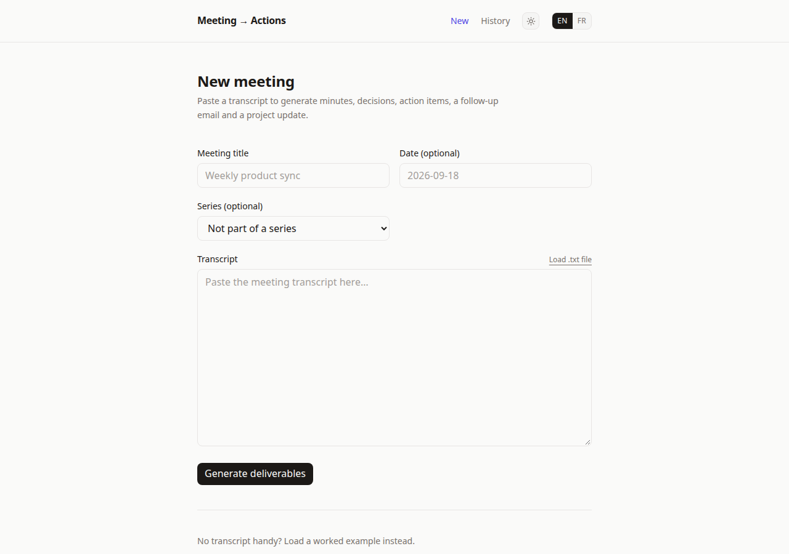
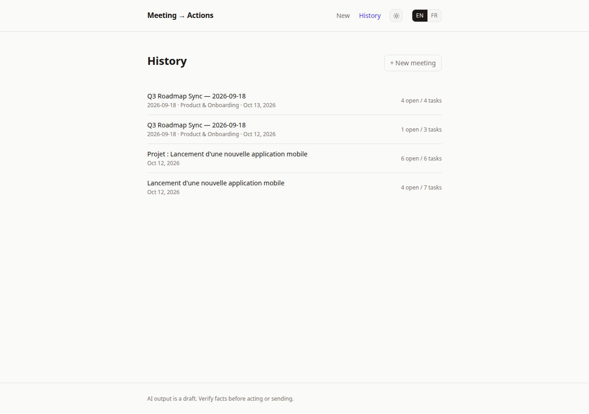

# Meeting → Actions

Paste a meeting transcript. Get back minutes, decisions, action items, a
follow-up email and a project update.



## Try it

1. `npm install && npm run dev` → http://localhost:3000
2. Click **Load sample meeting** (no API key needed).
3. Watch the recap stream in, actions first. Tick a checkbox, **Edit**
   anything, **Regenerate** to redo.




## What it does

- **Core recap**: summary, decisions, open questions and action items,
  streamed section by section.
- **Follow-up email and project update**: composed from the recap, so
  they always agree with it.
- **Review loop**: edit any field, mark actions done, regenerate.
- **Ownership honesty**: each owner and due date is labeled explicit,
  inferred or unknown, instead of passing guesses off as facts.
- **Series**: group recurring meetings; open actions and past decisions
  are passed along as context.
- **History**: past meetings and their recaps, stored locally.
- English/French, light/dark.

## How it works

```
transcript ──► model (core recap as JSON) ──► validate ──► save
                                                    │
                       email + project update ◄──────┘
                       composed in code, not generated
```

The model produces only the core recap, validated against a schema with
one repair retry on failure. Sections stream over NDJSON, actions first.
Reasoning models get their thinking tucked behind a collapsible panel.

## Setup

Copy `.env.example` to `.env` and set `OPENAI_API_KEY` (an OpenRouter
key; the default model is a free one). Without it, generation shows a
notice — the sample meeting still works.

| Variable | Default |
|----------|---------|
| `OPENAI_API_KEY` | (required for generation) |
| `OPENAI_BASE_URL` | `https://openrouter.ai/api/v1` |
| `OPENAI_MODEL` | `nvidia/nemotron-3-super-120b-a12b:free` |
| `DATABASE_PATH` | `./data/meetings.db` |

## Notes

- Storage is SQLite (`better-sqlite3`), single-user.
- On Vercel the database lives in `/tmp` (read-only filesystem), so
  history is ephemeral there — the sample meeting is always reloadable.

```bash
npm install
npm run dev      # http://localhost:3000
npm run lint
npm run build
```
